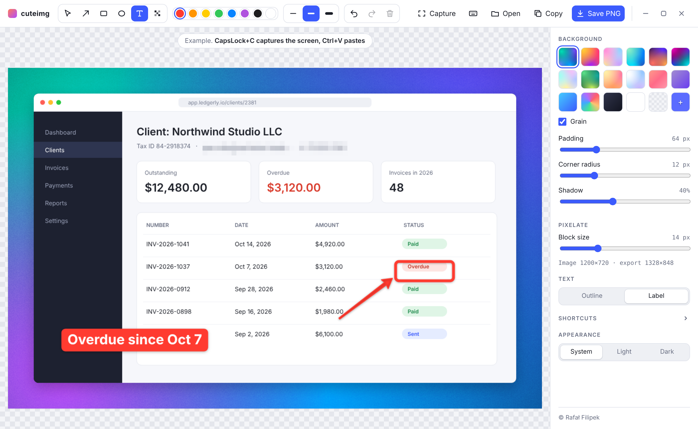

# cuteimg

Beautiful screenshots on Windows, macOS and Linux. Capture or paste a screenshot, put it on a gradient background, mark it up with arrows, rectangles, circles and text, pixelate anything private, then copy or save it. A CleanShot X–style editor built with [MyGo](https://mygo.egoist.dev).

<picture>
  <source media="(prefers-color-scheme: dark)" srcset="docs/screenshot-dark.png">
  
</picture>

## Features

- **Capture from anywhere** with a global shortcut. cuteimg hides, lets you select an area with the system's own tool, and opens the result in the editor.
- **Paste** an image with Ctrl+V, open a file, or drag one onto the window.
- **Backgrounds:** mesh gradients (Aurora, Lava, Candy, Lagoon, Dusk, Neon, Holo, Forest, Peach, Ice), linear gradients, a rainbow, white, a custom color or none, with optional film grain.
- **Frame:** padding, corner radius and drop shadow.
- **Annotations:** arrows, rectangles and ellipses in eight colors and three thicknesses. Hold Shift for a square, a circle or a 45° arrow. Select, move, resize and delete them.
- **Text** in two styles: bold text with an outline, or a label on a rounded color tag. Click to type, Shift+Enter for a new line, double-click to edit. The thickness buttons set its size.
- **Pixelate** an area to hide emails, names or tokens, with an adjustable block size.
- **Undo and redo** for every change.
- **Copy** the result to the clipboard (Ctrl+C) or **save** a PNG (Ctrl+S).
- Lives in the system tray, so closing the window keeps the shortcut working.

## Shortcuts

| Action | Windows | macOS | Linux |
|---|---|---|---|
| Capture an area (global, by default) | CapsLock+C | Cmd+Shift+2 | Ctrl+Shift+2 |
| Paste an image | Ctrl+V | ⌘V | Ctrl+V |
| Select / Arrow / Rectangle / Ellipse / Text / Pixelate | V / A / R / O / T / P | same | same |
| Edit a text | Double-click | Double-click | Double-click |
| Undo / Redo | Ctrl+Z / Ctrl+Y | ⌘Z / ⌘⇧Z | Ctrl+Z / Ctrl+Y |
| Delete the selected shape | Delete | Delete | Delete |
| Copy the result | Ctrl+C | ⌘C | Ctrl+C |
| Save a PNG | Ctrl+S | ⌘S | Ctrl+S |

Change the capture shortcut with the keyboard button in the toolbar: **Record new** takes the next combination you press, and **Test** checks that it reaches cuteimg. The choice is saved in `settings.json` next to the log.

On Windows, CapsLock works as a modifier while you hold it (CapsLock plus a letter, a digit, F1–F12 or Space). Tapping it on its own still toggles Caps Lock.

## How capture works

| System | Tool |
|---|---|
| Windows | The built-in Snipping overlay (`ms-screenclip:`). cuteimg picks up the selection from the clipboard. |
| macOS | `screencapture -i`. The first capture asks for the Screen Recording permission. |
| Linux | The first one installed of `grim` + `slurp`, `gnome-screenshot`, `spectacle`, `flameshot`, `maim` or `scrot`. |

If a capture fails, the log at `%APPDATA%\cuteimg\cuteimg.log` (Windows), `~/Library/Application Support/cuteimg/cuteimg.log` (macOS) or `~/.config/cuteimg/cuteimg.log` (Linux) says why.

## Install

Download the latest build from [Releases](https://github.com/RafalFilipek/cuteimg/releases):

- **Windows:** `cuteimg Setup <version> amd64.exe`, or the portable `cuteimg.exe`. The builds are not signed yet, so SmartScreen warns you: choose **More info**, then **Run anyway**.
- **macOS:** the `.dmg`. The app is not notarized yet, so open it the first time with right-click → **Open**.
- **Linux:** the `.deb`, or the `.tar.gz` with its `install.sh`.

## Build from source

You need [Go](https://go.dev) and [Bun](https://bun.sh). With [mise](https://mise.jdx.dev), `mise install` sets up Go from `mise.toml`.

```sh
bun install
bun run dev        # run with live reload
bun run build      # package for this system
bun run build -- -platform windows/amd64,linux/amd64,darwin/universal
```

MyGo needs no cgo, so any machine builds for every platform. The Windows installer needs NSIS (`apt install nsis` on Linux), and the macOS disk image needs a Mac.

## Project layout

| Path | What it is |
|---|---|
| `index.html` | The editor: canvas rendering, tools, backgrounds and export, in plain JavaScript |
| `src/main.ts` | Connects the editor to Go: copy, save, captured images and the shortcut dialog |
| `main.go` | The app: window, tray, clipboard, save dialog |
| `shortcut*.go` | The capture shortcut: registering, testing and saving it |
| `capture_*.go` | Screen capture for each system |
| `capslock_windows.go` | The keyboard hook behind CapsLock shortcuts on Windows |

## Updates

cuteimg checks for a new version once a day and shows its release notes with **Install Update**, **Remind Me Later** and **Skip This Version**. The tray menu has **Check for Updates…**. Updates come from this repository's latest release and are signed: the app accepts only files signed with the key whose public half is in `mygo.config.ts`. The portable Windows app doesn't update itself; the installed one does.

The release notes are the version's section in `CHANGELOG.md`, under a `## 0.2.0` heading. Add it before you release.

## Releases

1. Open **Actions → Release → Run workflow** and enter a version, such as `0.2.0`. The workflow sets it in `mygo.config.ts`, commits, and tags `v0.2.0`. You can also push a tag yourself after changing the version.
2. Windows, macOS and Linux build at the same time and upload to a draft release with generated notes.
3. Review the draft on the Releases page and publish it. Installed apps update to it from then on.

The workflow signs the updates with the `MYGO_UPDATER_PRIVATE_KEY` repository secret, the contents of `mygo-update.key` from `mygo keygen`. Keep that key safe: installed apps accept updates signed only with it.
